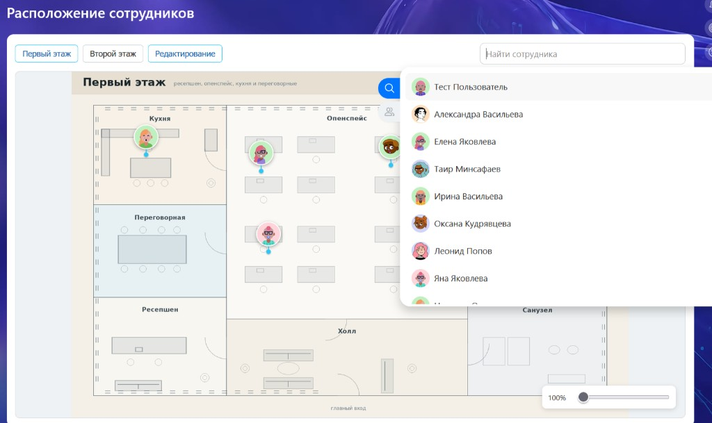
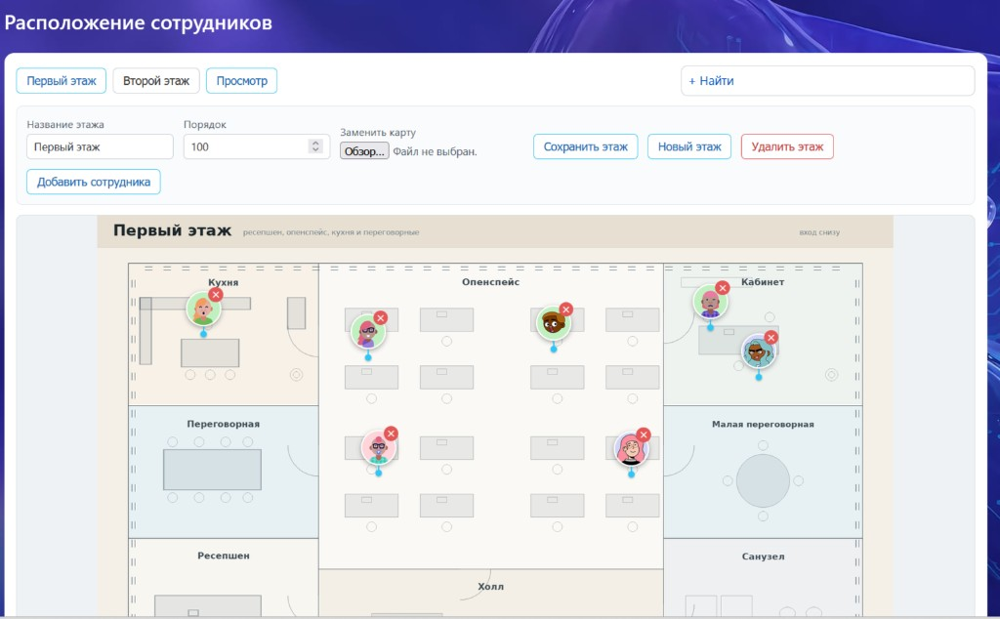
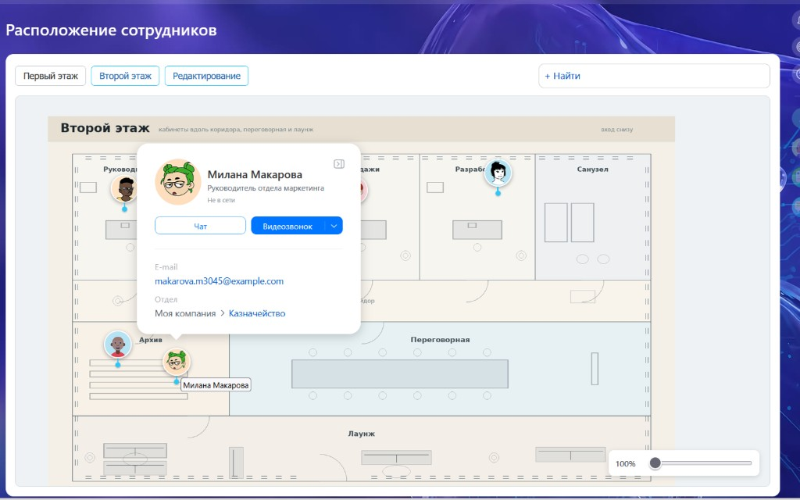

# Расположение сотрудников (mtai.stafflocation)

Модуль для портала Битрикс24: план офиса по этажам. Администратор загружает карту этажа и расставляет сотрудников. Остальные смотрят карту, двигают и масштабируют её и открывают штатный мини-профиль.

Решение самодостаточное: в репозитории PHP-модуль, компонент, публичная страница, исходники Vue и собранный `dist/`. На портале Node не нужен. Другие модули `mtai.*` не требуются.

## Скриншоты

Просмотр: план этажа, пины-аватары и штатный поиск сотрудника. Выбор из списка открывает его этаж и центрирует карту.



Редактирование: этажи, замена карты, перетаскивание пинов и удаление с плана.



Клик по пину в просмотре открывает штатный мини-профиль Bitrix24.



## Что использует из Битрикс24

- `iblock` — этажи и карты
- `highloadblock` — координаты пинов
- `intranet` — сотрудники, аватары, левое меню, мини-профиль `intranet.user.mini-profile`
- `ui` — выбор сотрудника (`ui.entity-selector`)

Коробочный «Управление сайтом» без `intranet` не поддерживается.

## Установка

Скопируйте папку `mtai.stafflocation/` в `<портал>/local/modules/` и установите модуль в админке: «Настройки → Настройки продукта → Модули → Расположение сотрудников».

Установщик создаёт:

- тип инфоблоков `mtai_stafflocation` и инфоблок «Этажи» (`mtai_staff_floors`);
- хайлоадблок `MtaiStaffLocationPin` (таблица `mtai_staff_location_pin`);
- страницу `/company/location/`;
- компонент `mtai:stafflocation.app`;
- бандл `/bitrix/js/mtai.stafflocation/dist/`;
- общий пункт левого меню «Расположение сотрудников».

Удаление модуля снимает страницу, компонент, бандл, пункт меню, инфоблок с этажами и хайлоадблок с координатами.

По умолчанию администраторы (группа 1) имеют полный доступ к инфоблоку, все пользователи (группа 2) — чтение. Режим редактирования на странице включается, если у пользователя есть право изменять элементы этого инфоблока.

## Как устроено

Элемент инфоблока — этаж: название (`NAME`), порядок (`SORT`), карта (`DETAIL_PICTURE`).

Пин сотрудника хранится в хайлоадблоке:

| Поле | Смысл |
| --- | --- |
| `UF_FLOOR_ID` | ID этажа |
| `UF_USER_ID` | ID сотрудника |
| `UF_POS_LEFT` | проценты от левого края карты |
| `UF_POS_TOP` | проценты от верхнего края карты |

Один сотрудник — одна точка на портале. Постановка на другой этаж переносит пин. Проценты не зависят от зума и сдвига карты.

Страница `/company/location/`:

- просмотр и редактирование: штатное поле выбора сотрудника (`ui.entity-selector`, вкладки сотрудников и отделов). Если он стоит на карте, открывается его этаж и карта центрируется на пине без мини-профиля. Если этаж один, переключатель в просмотре скрыт и сразу открывается этот план; пока картинка грузится, на карте прелоадер;
- несколько этажей — переключатель;
- пин — аватарка, якорь в кончике; при зуме растёт только карта, размер иконки не меняется; клик открывает штатный мини-профиль;
- карту можно двигать мышью; масштаб — ползунок (перетаскивание или щелчок по шкале) и колёсико;
- редактирование: этажи, замена карты, сотрудник через штатный селектор, перетаскивание пина.

Ссылка на сотрудника: `/company/location/?user=123`. Если он стоит на карте, открывается его этаж, масштаб около 250%, карта центрируется на пине и показывается мини-профиль.

## Сборка клиента

Клиент — Vite-проект в `mtai.stafflocation/install/client/` (скаффолд [MTai88/vite](https://github.com/MTai88/vite): Vue 3, TypeScript, Tailwind с префиксом `tw-`). Каталог `dist/` уже собран и лежит в репозитории.

Пересборка:

```bash
cd mtai.stafflocation/install/client
npm ci
npm run build
```

После пересборки переустановите модуль, чтобы установщик заново скопировал `dist/` в `/bitrix/js/mtai.stafflocation/dist/`.

Сборка в Docker, если Node на машине нет:

```bash
docker run --rm -v "$PWD:/app" -w /app node:22-alpine sh -c "npm ci && npm run build"
```

Команду запускайте из `mtai.stafflocation/install/client`.

## Требования

- PHP >= 8.1
- Модули Битрикс24: `iblock`, `highloadblock`, `intranet`, `ui`
- Права на запись в `/local/components/`, `/bitrix/js/` и корень сайта

## Лицензия

Source-available. Некоммерческое использование и 30-дневная
ознакомительная оценка — бесплатно; **коммерческое использование
(включая установку на портал компании и работы для клиентов) требует
платной коммерческой лицензии** — условия и покупка: mintair@mail.ru.
Подробности — [LICENSE](LICENSE).
